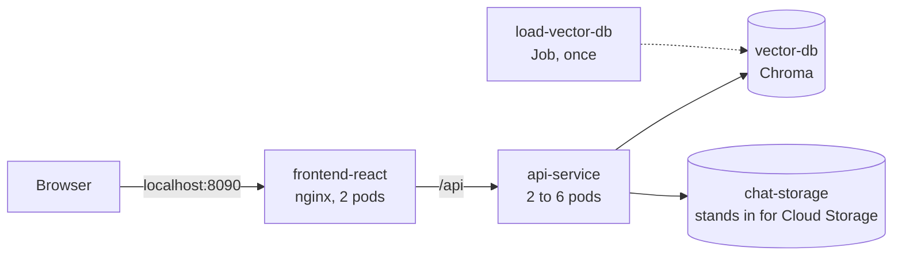
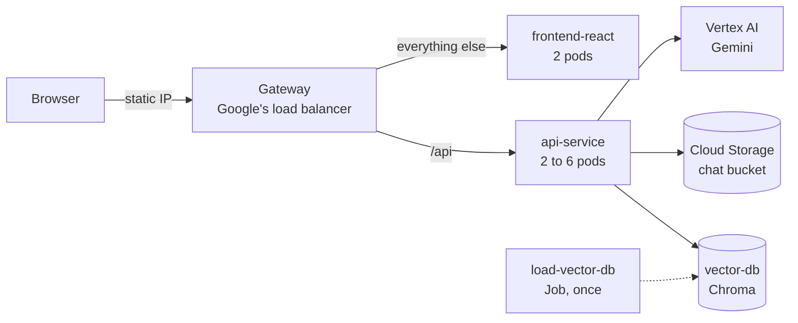

# Cheese App - Deployment & Scaling

In `cheese-app-v2` we ran the Cheese App on our laptop, in containers. In this tutorial we run the same
containers on Kubernetes, first on our laptop and then on Google Cloud:

| Tutorial | Where it runs | What it shows |
| --- | --- | --- |
| [Kubernetes on your laptop](#tutorial-kubernetes-on-your-laptop) | kind, a cluster in Docker | Scaling, rolling updates and self-healing, for free |
| [Deploy to a VM by hand](#tutorial-deploy-to-a-vm-by-hand) | One Compute Engine VM | Every step of a deployment, typed by hand |
| [Deploy to a VM with Pulumi](#tutorial-deploy-to-a-vm-with-pulumi) | One Compute Engine VM | The same steps as code |
| [Kubernetes on GKE](#tutorial-kubernetes-on-gke) | A GKE cluster | The laptop cluster's YAML, on Google Cloud |

These are the pieces that run in each cluster:

| Folder | In the cluster | What it is |
| --- | --- | --- |
| `src/vector-db/` | `vector-db`, a StatefulSet with a disk | Chroma, the vector database for RAG |
| `src/vector-db/` | `load-vector-db`, a Job | Loads the cheese books into Chroma, once |
| `src/api-service/` | `api-service`, a Deployment with an autoscaler | FastAPI: content, and chat with Gemini, a CNN and RAG |
| `src/frontend-react/` | `frontend-react`, a Deployment | The page, served by nginx, which passes `/api` to the API |

The code is the code from `cheese-app-v2`, with one change: chats can now live in a Cloud Storage
bucket instead of a folder, so every copy of the API sees the same chats. The routes, messages and
settings the frontend and the API agree on are in [docs/contract.md](docs/contract.md).

## Prerequisites
- The `cheese-app-v2` tutorial, done
- Docker, with at least 8 GB of memory and 4 CPUs for Docker (Docker Desktop: **Settings > Resources**),
  and port 8090 free
- The `ml-workflow.json` service account key from `cheese-app-v2`. The account needs the
  **Vertex AI User** role.
- About 15 GB of free disk space
- For the Google Cloud tutorials: a project with billing on. A VM or a cluster costs money every hour
  it runs, so delete it when you are done.

## Tutorial: Environment Setup

### Clone the GitHub repository
- Clone or download from [here](https://github.com/dlops-io/cheese-app-v3)

### Create the local folders

We never put secrets in Git, so they live outside the repository. Next to the `cheese-app-v3` folder,
create a **secrets** folder, with your `ml-workflow.json` in it. You will add two more keys before the
Google Cloud tutorials.

Your folder structure should look like this:
```
   |-cheese-app-v3
     |-docs
     |-src
       |---api-service
       |---deployment
       |---frontend-react
       |---vector-db
   |-secrets
     |---ml-workflow.json
     |---deployment.json      (for Google Cloud)
     |---gcp-service.json     (for Google Cloud)
```

### Set your Google Cloud project
Change `GCP_PROJECT` to your own project ID at the top of `src/deployment/docker-shell.sh`.

To develop the code, use each folder's `docker-shell.sh` as in `cheese-app-v2`. For those, change
`GCP_PROJECT` in `src/api-service/docker-shell.sh` and `src/vector-db/docker-shell.sh` too, and create
a **persistent-folder** next to **secrets**, as in `cheese-app-v2`.

## Tutorial: Deployment Container
Every tool we need, at pinned versions, is in one container: kind, kubectl, Pulumi, gcloud and the
Docker CLI. Docker is the only thing your laptop needs.

1. Build and run the container:
```bash
cd src/deployment
```

```bash
./docker-shell.sh
```

The first build takes a few minutes. Without `secrets/deployment.json` it skips logging in to Google
Cloud and Pulumi, and the laptop cluster still works.

2. Check the tools:
```bash
kind version
```

```bash
kubectl version --client
```

3. For a second shell in the same container, run `./docker-shell.sh` again from another terminal.

The container drives your laptop's Docker through its socket: kind's nodes and the images it builds
are ordinary containers and images on your laptop.

## Tutorial: Kubernetes on your laptop
kind runs a Kubernetes cluster as three containers on your laptop: one control plane and two workers.
Everything in this tutorial runs inside the deployment container.



### Create the cluster
1. Create it, with metrics-server, which measures each pod's CPU for the autoscaler. This takes about a
   minute:
```bash
./scripts/create-cluster-kind.sh
```

2. See the nodes. Each one is a Docker container:
```bash
kubectl get nodes
```

### Deploy the app
1. Build the images, copy them into the nodes and start everything. About 5 minutes the first time,
   because of the API's image:
```bash
./scripts/deploy-kind.sh
```

2. Open http://localhost:8090 and try the three chat modes: **Ask**, **Identify** with a photo, and
   **Cheese books**.

3. See what is running:
```bash
kubectl get pods -o wide
```

```bash
kubectl get deployments,statefulsets,jobs,services,hpa
```

- Two `frontend-react` pods and two `api-service` pods, spread over the two workers
- `vector-db-0`, Chroma, with its own disk
- `load-vector-db`, `Completed`: it loaded 14,356 chunks of the books and stopped
- `chat-storage`, which only the laptop cluster has. See [Chats live outside the pods](#chats-live-outside-the-pods)

### Let Kubernetes add pods
The autoscaler (`k8s/base/hpa.yaml`) keeps between 2 and 6 API pods, and adds one when their CPU is
above 70% of what each pod asked for.

1. In a second shell, watch the pods and the autoscaler:
```bash
kubectl get pods,hpa -w
```

2. In the first shell, send 3000 **Identify** requests, 8 at a time. Each one is a cheese photo for the
   CNN, which takes CPU, and none of them call Gemini, so this costs nothing:
```bash
./scripts/load.sh 3000 8
```

What we saw on a laptop:
- The first new pod arrives about 20 s after the load starts, and the API reaches 6 pods
- All 3000 requests answer, in about 2 minutes, 95% of them within 1 s
- About 1.5 minutes after the load stops, the autoscaler is back to 2 pods

### Update the app while people use it
1. In the first shell, start the load again, in the background:
```bash
./scripts/load.sh 1000 8 &
```

2. Replace every API pod, one at a time:
```bash
kubectl rollout restart deployment/api-service
```

```bash
kubectl rollout status deployment/api-service
```

When `load.sh` finishes, every request has an answer. Each new pod is ready before an old one leaves
(`maxUnavailable: 0`), and a leaving pod finishes the answers it has started.

### Delete pods
1. Delete Chroma's pod:
```bash
kubectl delete pod vector-db-0
```

```bash
kubectl get pods -w
```

The StatefulSet makes a new `vector-db-0` in a second or two, on the same disk, so the books are
still there: ask **Cheese books** another question.

2. Delete an API pod. Pick one from `kubectl get pods`:
```bash
kubectl delete pod <api-service pod name>
```

The Deployment replaces it. The page keeps working, because the other pod is still there.

### Chats live outside the pods
Start a chat on the page, then send the load again. The new pods know your chat too: on the left,
under **Recent**, it is still there.

Every API pod reads and writes chats in one shared place, `chat-storage`. On GKE that is a Cloud
Storage bucket. On the laptop, `chat-storage` stands in for it: the API's Cloud Storage code is the
same, and `STORAGE_EMULATOR_HOST` sends its calls to the stand-in instead of to Google. Without it,
each pod would keep its own chats, and they would seem to vanish whenever the autoscaler adds a pod.

The stand-in keeps the chats in memory: they last until its pod or the cluster is deleted.

### Look inside
| Command | What it shows |
| --- | --- |
| `kubectl describe pod <pod name>` | Where the pod runs, its probes and its recent events |
| `kubectl logs deployment/api-service -f` | One API pod's log, as it happens |
| `kubectl logs job/load-vector-db` | The books being loaded |
| `kubectl exec -it deployment/api-service -- bash` | A shell in an API pod. `exit` to leave |
| `kubectl top pods` | Each pod's CPU and memory, from metrics-server |
| `kubectl get events --sort-by=.lastTimestamp` | What the cluster did, newest last |

### Review the code
| File | What it does |
| --- | --- |
| `kind.yaml` | The cluster: three nodes, and `localhost:8090` mapped to the frontend |
| `k8s/base/` | What every cluster runs, the same on the laptop and on GKE |
| `k8s/base/api-service.yaml` | The API: its settings, CPU and memory, probes, and the rolling update |
| `k8s/base/hpa.yaml` | The autoscaler: 2 to 6 API pods at 70% CPU |
| `k8s/base/vector-db.yaml` | Chroma as a StatefulSet, with a 5 GB disk |
| `k8s/base/frontend-react.yaml` | nginx and the page, and `API_URL`, where it sends `/api` |
| `k8s/load-vector-db/job.yaml` | The Job that loads the books |
| `k8s/kind/` | What the laptop needs on top: the chat storage stand-in, your key and the port |
| `scripts/deploy-kind.sh` | Builds the images, `kind load`s them into the nodes and applies `k8s/kind` |
| `scripts/load.sh` | The load: Identify requests, any number, any number at a time |

Three things to notice in `k8s/base/api-service.yaml`:
- There is no `replicas`: the autoscaler decides how many pods there are.
- The readiness probe (`/readyz`) keeps a pod out of the Service until its CNN model has loaded and
  Chroma answers. The liveness probe (`/healthz`) restarts a pod only if the process stops answering.
- `kubectl apply -k k8s/kind` puts `base/` and `kind/` together. Kustomize builds what is applied, so
  the files in `base/` never change from one cluster to the next.

### Rehearse it
`verify-kind.sh` deletes the cluster, builds a new one and checks everything in this tutorial. It
takes about 12 minutes and asks Gemini one question (`SKIP_GEMINI=1` leaves that out):
```bash
./scripts/verify-kind.sh
```

### Delete the cluster
```bash
./scripts/delete-cluster-kind.sh
```

## Tutorial: Google Cloud Setup
Do this once, before the Google Cloud tutorials.

> **Note:** the three Google Cloud tutorials below are new this term and have not been run on Google
> Cloud yet. The laptop tutorial above has.

### Enable the APIs
Search for each of these in the Google Cloud console and enable it:
- Compute Engine API
- Kubernetes Engine API
- Artifact Registry API
- Vertex AI API
- Identity and Access Management (IAM) API
- Cloud Resource Manager API
- Service Usage API

### Create the service accounts
In the console, go to **IAM & Admin > Service accounts** and create two accounts. For each one,
choose **Actions > Manage keys > Add key > JSON**, and save the key in your **secrets** folder with the
name below.

| Account | Key file | Roles | Used by |
| --- | --- | --- | --- |
| `deployment` | `deployment.json` | Compute Admin, Artifact Registry Administrator, Kubernetes Engine Admin, Storage Admin, Service Account User, Service Account Admin | The deployment container, to create everything |
| `gcp-service` | `gcp-service.json` | Vertex AI User, Artifact Registry Reader | The app on Google Cloud, to call Gemini and pull images |

Service Account Admin lets Pulumi allow the API's pods on GKE to act as `gcp-service`, so they need no
key file. `deploy_base` gives `gcp-service` access to the chat bucket.

### Set your project in the Pulumi stacks
Replace `ac215-project` with your project ID in these files:
- `src/deployment/deploy_base/Pulumi.dev.yaml` (twice)
- `src/deployment/deploy_images/Pulumi.dev.yaml`
- `src/deployment/deploy_vm/Pulumi.dev.yaml`
- `src/deployment/deploy_k8s/Pulumi.dev.yaml` (three times)

Then leave the deployment container with `exit` and start it again. With `deployment.json` there, it
logs in to Google Cloud and keeps Pulumi's state in a bucket, `gs://<your project>-pulumi-state-bucket`:
```bash
./docker-shell.sh
```

```bash
gcloud auth list
```

## Tutorial: Deploy to a VM by hand
We create one VM and start the same four containers on it, typing every step ourselves.

### Push the images to Docker Hub
Sign up at [Docker Hub](https://hub.docker.com), then, from the `cheese-app-v3` folder on your laptop
(not in a container), log in and push the three production images. Replace `YOUR_USER` with your
Docker Hub username. Google's VMs are `linux/amd64`, so we build for that, whatever your laptop is:
```bash
docker login -u YOUR_USER
```

```bash
docker buildx build --platform linux/amd64 -t YOUR_USER/cheese-app-api-service --push src/api-service
```

```bash
docker buildx build --platform linux/amd64 -t YOUR_USER/cheese-app-frontend-react --push src/frontend-react
```

```bash
docker buildx build --platform linux/amd64 -t YOUR_USER/cheese-app-vector-db-cli --push src/vector-db
```

### Create the VM
In the console, go to **Compute Engine > VM instances > Create instance**. Keep the defaults, except:
- Machine type: **n2d-standard-2**
- **OS and storage:** a 50 GB disk
- **Networking:** allow HTTP traffic

Then choose **SSH** next to the new VM.

### Install Docker
On the VM:
```bash
curl -fsSL https://get.docker.com -o get-docker.sh
```

```bash
sudo sh get-docker.sh
```

```bash
sudo docker --version
```

### Create the folders and the key
```bash
sudo mkdir persistent-folder secrets
```

```bash
sudo chmod 0777 persistent-folder secrets
```

Paste the contents of your `gcp-service.json` between the quotes:
```bash
echo '<___Json Key___>' > secrets/gcp-service.json
```

### Start the containers
1. A network, so the containers find each other by name:
```bash
sudo docker network create cheese-app-network
```

2. Chroma:
```bash
sudo docker run -d --name cheese-app-vector-db --network cheese-app-network -e ANONYMIZED_TELEMETRY=FALSE -v "$(pwd)/docker-volumes/chromadb":/data --restart always chromadb/chroma:1.5.9
```

3. Load the books. This downloads the embeddings we made for you, so it needs no key:
```bash
sudo docker run --rm --network cheese-app-network -e GCP_PROJECT=YOUR_PROJECT -e CHROMADB_HOST=cheese-app-vector-db -e CHROMADB_PORT=8000 YOUR_USER/cheese-app-vector-db-cli cli.py --download --load --chunk_type recursive-split
```

4. The API:
```bash
sudo docker run -d --name cheese-app-api-service --network cheese-app-network -v "$(pwd)/persistent-folder":/persistent -v "$(pwd)/secrets":/secrets:ro -e GOOGLE_APPLICATION_CREDENTIALS=/secrets/gcp-service.json -e GCP_PROJECT=YOUR_PROJECT --restart always YOUR_USER/cheese-app-api-service
```

5. The frontend, on port 80. Start it after the API: nginx looks the API up when it starts.
```bash
sudo docker run -d --name cheese-app-frontend-react --network cheese-app-network -p 80:80 --restart always YOUR_USER/cheese-app-frontend-react
```

6. Open `http://<your VM's external IP>`. The API docs are at `http://<your VM's external IP>/api/docs`.

There is no separate web server: the frontend image is nginx, and it passes `/api` to the API, the
same as on the laptop. Only port 80 is open to the world.

### Look inside
```bash
sudo docker ps
```

```bash
sudo docker logs cheese-app-api-service -f
```

```bash
sudo docker exec -it cheese-app-api-service bash
```

The frontend's image is Alpine Linux, which has `sh` rather than `bash`.

If you replace the API container, restart the frontend too: nginx keeps the address it looked up, and
answers `502` until it restarts. On Kubernetes, a Service gives the API one address that never changes.
```bash
sudo docker restart cheese-app-frontend-react
```

### Delete the VM
In the console, select the VM and choose **Delete**.

## Tutorial: Deploy to a VM with Pulumi
Now the same deployment as code. Pulumi creates the VM, and the VM runs `deploy_vm/startup.sh` when it
boots: the commands you typed by hand, as a script. Run everything in the deployment container.

### Create the shared pieces
`deploy_base` holds what outlives a VM or a cluster: a static IP for GKE, an Artifact Registry
repository for our images, and a bucket for the chats.
```bash
cd /app/deploy_base && pulumi stack init dev && pulumi up --stack dev -y
```

### Build and push the images
`deploy_images` builds the three production images for `linux/amd64` and pushes them to Artifact
Registry. A few minutes the first time:
```bash
cd /app/deploy_images && pulumi stack init dev && pulumi up --stack dev -y
```

Each image's tag is a hash of its files, so an image is only rebuilt, and pods only replaced, when its
code changes.

### Create the VM
```bash
cd /app/deploy_vm && pulumi stack init dev && pulumi up --stack dev -y
```

Pulumi finishes before the VM does: the VM still has to install Docker, pull the images and load
the books. Watch it, until you see `Cheese App containers started`:
```bash
gcloud compute instances get-serial-port-output cheese-app-vm --zone us-central1-a | grep startup-script
```

Then open the address Pulumi printed:
```bash
pulumi stack output app_url
```

What is different from doing it by hand:
- **No key file on the VM:** it runs as `gcp-service`, so Gemini and Artifact Registry work without one
- **The chats are in the bucket,** so they outlive the VM
- **New images replace the whole VM.** Run `deploy_images` and then `deploy_vm` again, and the app is down
  for a few minutes while the new VM starts. Kubernetes replaces pods one at a time instead.

To look inside, choose **SSH** next to the VM in the console, and use `sudo docker ps` as before.

### Delete the VM
```bash
cd /app/deploy_vm && pulumi destroy --stack dev -y
```

## Tutorial: Kubernetes on GKE
The YAML from the laptop cluster, on a GKE cluster. Run everything in the deployment container, after
`deploy_base` and `deploy_images` from the previous tutorial.



### Create the cluster
`deploy_k8s` creates a network, a GKE cluster with three `e2-standard-2` nodes, and Workload Identity,
which lets the API's pods act as `gcp-service` with no key file. About 10 minutes:
```bash
cd /app/deploy_k8s && pulumi stack init dev && pulumi up --stack dev -y
```

### Deploy the app
```bash
cd /app && ./scripts/deploy-k8s.sh
```

It applies `k8s/gke`: everything in `k8s/base`, plus a Gateway, which makes Google's load balancer.
It also pins the images `deploy_images` pushed and fills in your project. When it is done it prints
the app's address. The load balancer can take a few minutes more before that address answers.

### Try it
The commands from the laptop work here too, with `-n cheese-app`:
```bash
kubectl -n cheese-app get pods,hpa -w
```

```bash
./scripts/load.sh 3000 8 http://<the app's address>
```

`deploy-k8s.sh` switched kubectl to the GKE cluster. To go back to the laptop cluster:
```bash
kubectl config use-context kind-cheese-app
```

### Review the code
| File | What it does |
| --- | --- |
| `deploy_base/__main__.py` | The static IP, the Artifact Registry repository and the chat bucket |
| `deploy_images/__main__.py` | Builds and pushes the images, tagged by a hash of their files |
| `deploy_vm/__main__.py`, `startup.sh` | The VM, its network and firewall, and what it runs at boot |
| `deploy_k8s/` | The network, Cloud NAT, the cluster, its nodes and Workload Identity |
| `k8s/gke/gateway.yaml` | The Gateway: `/api` to the API, everything else to the frontend |
| `scripts/deploy-k8s.sh` | Pins the images and your settings in an overlay, then applies `k8s/gke` |
| `scripts/destroy-k8s.sh` | Takes the cluster down in the right order |

### Delete the cluster
Delete the workloads first, so that Google removes the load balancer, then the cluster:
```bash
cd /app && ./scripts/destroy-k8s.sh
```

## Troubleshooting

| What you see | What to do |
| --- | --- |
| `deploy-kind.sh` says `ml-workflow.json is missing` | Put the key in your **secrets** folder, then start the deployment container again |
| `port is already allocated` when creating the cluster | Something else uses 8090. Stop it, or run `docker ps` to find it |
| Pods stay `Pending` on the laptop | Docker has too little memory. Give it more in Docker Desktop, or stop other containers |
| An API pod is `0/1` for minutes | It downloads the CNN model from GitHub when it starts, so it needs the internet. Check with `kubectl logs <pod name>` |
| `ErrImageNeverPull` or `ImagePullBackOff` on the laptop | The images are not in the nodes. Run `./scripts/deploy-kind.sh` again |
| kubectl answers about the wrong cluster | Check with `kubectl config current-context`, then `kubectl config use-context kind-cheese-app` |
| Ask says `Gemini: 403` or `PERMISSION_DENIED` | Check `GCP_PROJECT`, the Vertex AI API and the service account's role |
| Ask says `Gemini: 404` | Google retired the model. Change `GENERATIVE_MODEL` in `api/settings.py` |
| The VM's page does not load | It is still starting: watch the serial port output, as in the Pulumi VM tutorial |
| `deploy_k8s` fails with `iam.serviceAccounts.setIamPolicy` | Give `deployment` the Service Account Admin role, then `pulumi up` again |
| The GKE address does not answer yet | The load balancer takes a few minutes. Check with `kubectl -n cheese-app get gateway` |

## Cleanup

On the laptop:
```bash
cd /app && ./scripts/delete-cluster-kind.sh
```

On Google Cloud, delete what costs money first, then the shared pieces. Destroying `deploy_images`
only forgets the images; they go with the repository:
```bash
cd /app && ./scripts/destroy-k8s.sh
```

```bash
cd /app/deploy_vm && pulumi destroy --stack dev -y
```

```bash
cd /app/deploy_images && pulumi destroy --stack dev -y
```

```bash
cd /app/deploy_base && pulumi destroy --stack dev -y
```

The next command removes images and containers you are not using, across all your projects, so check
the list it shows you first:
```bash
docker system prune
```
